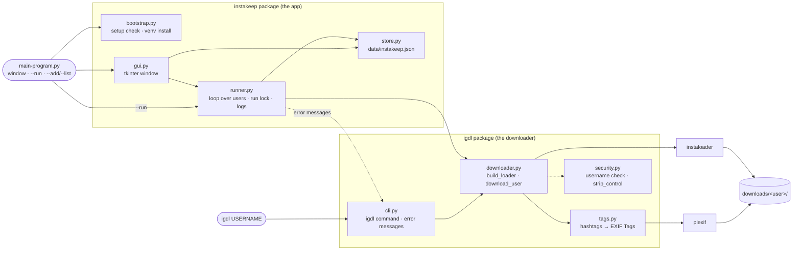

# InstaKeep: download a list of Instagram profiles

InstaKeep keeps a list of public Instagram profiles and downloads the newest posts of each (5 by default), from a window or the command line. It saves images only unless you ask for more, and it writes every `#hashtag` from a post's caption into its images' Tags, which Windows shows under Properties → Details. Videos, caption files and metadata are opt-in; Tags can be turned off. It's built on [instaloader](https://instaloader.github.io/).

You'll mostly use `main-program.py`, which opens the window and also has list commands such as `--run` and `--add`. For a one-off download of a single profile from the terminal, there's `igdl USERNAME`.

## Start

```powershell
cd InstaKeep
python main-program.py      # Windows (not python3, which opens the Microsoft Store)
python3 main-program.py     # macOS / Linux
```

You don't need to install anything first. On the first start the program checks its setup:

| Check | If it fails |
|-------|-------------|
| Python 3.10+ | Explains and exits. |
| tkinter (window only) | Prints the install command for your OS. |
| instaloader, piexif | Asks, then creates `.venv`, runs `pip install -e .` into it, and restarts inside it. |

From then on, `python main-program.py` switches to `.venv` by itself. Run `python main-program.py --check` to see the setup status.

## The window

The window has two tabs. **Batch** works on your saved list of users. **Individual** downloads one post from its link. Below the tabs, the download options, **Stop**, **Open folder** and the log are shared by both, and only one download runs at a time.

### Batch

| Part | What it does |
|------|--------------|
| User table | Your saved list. Last downloaded shows when and how it went (e.g. `2026-11-02 08:00  ok, 3 new`). Time counts up while that user downloads, then shows how long the run took. Total time, Images and Videos add up every download of that user. |
| Username box + **Add** | Adds a user (Enter works too). You can type `@name`. Invalid names and duplicates are refused. |
| **Remove selected** (or Delete key) | Removes users from the list. Downloaded files are kept. |
| Download all posts / Newest _N_ posts per user | Newest 5 by default. Tick Download all posts to get every post; the Newest box is greyed out while it's ticked. Both are also used by `--run`. |
| Videos / Caption (.txt) / #tags / Metadata | #tags starts on and the others start off. See [Captions and hashtag Tags](#captions-and-hashtag-tags). |
| **Download all** / **Download selected** | Downloads for those users. **Stop** finishes the current post and then stops, and it also works during a rate-limit pause. |
| **Open folder** | Opens the selected user's folder, or the output folder. |

### Individual

Paste a post or reel link, such as `https://www.instagram.com/p/DXwaXSSEuX8/` (anything after the code, like `?igsh=...`, is ignored), and press **Download post** or Enter. It uses one Instagram request for the post's details.

- The post is saved in `downloads/<account>/` with the same file names Batch uses, so a later Batch download of that account skips it.
- Videos, Caption, #tags and Metadata apply as they do in Batch. With Videos off, a video post is skipped and the log says so.
- Tick **Also add the post's account to the saved list** to add its account to the Batch list once the post has loaded.
- **Open folder** on this tab opens the folder of the last post's account.
- Only public accounts work. A deleted post and a private account's post both show "couldn't be loaded".

Changes are saved to `data/instakeep.json` as you make them, so the list and options are still there next time.

Files go to `InstaKeep/downloads/<username>/` unless you pick another folder. Existing files are skipped, so each run only adds new posts.

If one user fails because the profile doesn't exist or is private, the others still run. If Instagram rate-limits or blocks requests, the remaining users are skipped.

### Estimated download time

The window estimates how long Download all and Download selected will take, from each user's records: how long their images and videos took, how many files a post has, and how many new posts the last download found. A user who hasn't been downloaded yet gets typical values. The estimate also adds rate-limit pauses: instaloader allows about 200 Instagram requests per 11 minutes and waits once it gets there, and if earlier downloads paused more than that (Instagram can block for longer), the estimate uses what they saw. With Download all posts, a user's total post count is only known after their first download.

## Command line

```powershell
python main-program.py                     # window
python main-program.py --run               # download for all saved users, no window
python main-program.py --check             # setup status
python main-program.py --list
python main-program.py --add natgeo nasa
python main-program.py --remove nasa
```

`--run` appends to `logs/run-YYYY-MM-DD.log` and keeps the last 30 log files. A `--run` and the window never download at the same time; whichever starts second gives up and says so.

Known problems (a profile that doesn't exist, a private profile, a rate limit) get one short line. Anything unexpected is a bug: you get its Python traceback, in the terminal, in the window's log, or in the `--run` log file.

| Exit code (`--run`) | Meaning |
|---|---|
| 0 | every user OK |
| 1 | at least one user failed, or a bug (with a traceback) |
| 3 | setup incomplete (run `python main-program.py` once to install) |
| 4 | rate-limited or blocked by Instagram |
| 5 | another download was already running |
| 130 | interrupted (Ctrl+C) |

## Single profile: `igdl`

`igdl` is installed into `.venv` with everything else. Activate the venv (`.venv\Scripts\activate`, or `source .venv/bin/activate` on macOS/Linux), then:

```powershell
igdl USERNAME [-o DIR] [--limit N] [--videos] [--caption] [--no-tags] [--metadata] [-q]

igdl natgeo --limit 10                # newest 10 image posts, hashtag Tags written -> InstaKeep/downloads/natgeo/
igdl natgeo --limit 10 --videos       # newest 10 posts, videos included
igdl natgeo --caption                 # all image posts + caption .txt
igdl natgeo --no-tags                 # all image posts, images left untouched
igdl natgeo -o D:\ig --metadata       # all image posts + .json data -> D:\ig\natgeo\
```

| Exit code (`igdl`) | Meaning |
|---|---|
| 0 | success |
| 1 | profile not found |
| 2 | private profile (can't be downloaded without login) |
| 4 | rate-limited or blocked by Instagram |
| 130 | interrupted (Ctrl+C) |

## What gets downloaded

| | Default (images only) | With videos on |
|---|---|---|
| Photo posts | saved | saved |
| Video and reel posts | skipped (not counted toward the limit) | `.mp4` + cover image |
| Video slides in a carousel | skipped | `.mp4` + cover image |

"Newest N" means the N most recent posts by date. A profile can pin up to 3 posts, which Instagram always lists first, so InstaKeep reads 3 extra posts and keeps the N newest. A pinned post is included only if it's among those N.

Each post is saved as `<username>_YYYY-MM-DD_HH-MM-SS_<shortcode>`, for example `natgeo_2026-11-01_23-53-04_DfN9Oosk9s2_1.jpg`:

| File | When |
|------|------|
| `.jpg` | always. Carousels get `_1`, `_2`, … suffixes |
| `.mp4` | with videos on |
| `.txt` (caption) | with captions on |
| `.json` (full post data) | with metadata on |

### Captions and hashtag Tags

These are two separate options. With #tags on (the default; `igdl --no-tags` turns it off), every image of a post gets the caption's `#hashtags` as Tags, and no extra file is created. With Caption (.txt) on (off by default; `igdl --caption`), each post also gets a `.txt` file with the full caption.

| Caption | Tags written |
|---------|--------------|
| `Wow this #portrait is awesome.` | `#portrait` |
| `#film #Portrait, shot on #cinestill800t #film` | `#film; #Portrait; #cinestill800t` |

- A tag is `#` followed by letters, digits or `_`, in any language. Duplicates are dropped, ignoring case.
- To see them in Windows Explorer, right-click an image and open Properties → Details → Tags, or search with `tags:#portrait`. They're stored in the EXIF `XPKeywords` field.
- The image isn't re-encoded, so quality doesn't change. Only `.jpg` files get tags.
- With #tags on, each run also tags earlier downloads that don't have Tags yet.

## Architecture



| Path | What |
|------|------|
| [`main-program.py`](main-program.py) | Entry point: setup check, then window or command-line mode. |
| [`src/instakeep/bootstrap.py`](src/instakeep/bootstrap.py) | Setup check and venv install (standard library only). |
| [`src/instakeep/store.py`](src/instakeep/store.py) | Saved users and settings. |
| [`src/instakeep/runner.py`](src/instakeep/runner.py) | Downloads for each user, records results, run lock, `--run` logging. |
| [`src/instakeep/gui.py`](src/instakeep/gui.py) | The tkinter window: Batch and Individual tabs. |
| [`src/igdl/cli.py`](src/igdl/cli.py) | The `igdl` command; maps errors to messages and exit codes. |
| [`src/igdl/downloader.py`](src/igdl/downloader.py) | Configures instaloader, reports rate-limit pauses, runs the download loop, downloads a single post. |
| [`src/igdl/tags.py`](src/igdl/tags.py) | Writes caption hashtags into a JPEG's EXIF Tags. |
| [`src/igdl/security.py`](src/igdl/security.py) | Username and post-link checks, stripping control and bidi characters, one-line error messages. |

`.venv/`, `data/`, `logs/` and `downloads/` are created at runtime and are git-ignored.

## Tests

```powershell
.venv\Scripts\pip install -e .[dev]
.venv\Scripts\python -m pytest
```

## Caveats

- It only works for public profiles, because there is no login. Instagram may show logged-out visitors fewer posts or block their requests (401/429). If that happens, wait a while and try again.
- Scraping goes against Instagram's Terms of Service. Use this for profiles you have permission to archive.
- instaloader slows itself down to stay under Instagram's limits, and a pause can last several minutes. The log shows something like `Instagram rate limit: pausing 6 min (until 14:05)`, and the download carries on afterwards.
