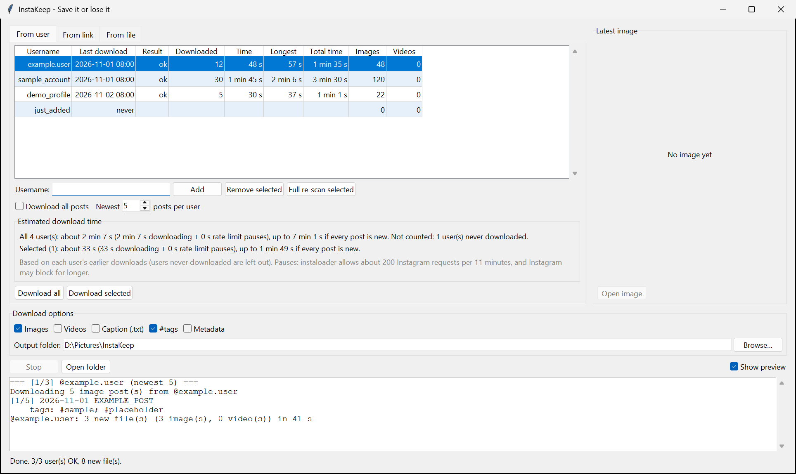
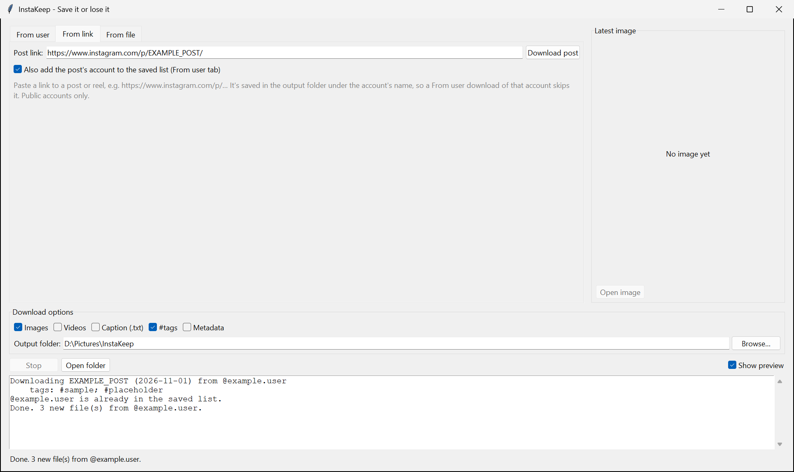
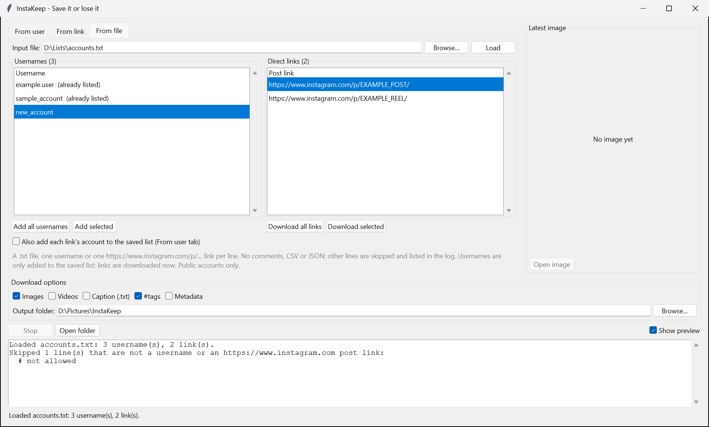

# InstaKeep: Save it or lose it

InstaKeep keeps a list of public Instagram profiles and downloads the newest posts of each, from a window or the command line. By default it saves the 5 newest image posts per profile and writes each caption's `#hashtags` into the images' Tags, which Windows shows under Properties → Details. Videos, caption files and post data are optional. Each run only adds what's new.

There's no login, so only public profiles work. It's built on [instaloader](https://instaloader.github.io/).

The [design document](docs/SDD.md) explains how it works inside.

## Start

```powershell
cd InstaKeep
python instakeep.py      # Windows (not python3, which opens the Microsoft Store)
python3 instakeep.py     # macOS / Linux
```

You don't need to install anything first. On the first start, InstaKeep checks your setup:

| Check | If it fails |
|-------|-------------|
| Python 3.10+ | Explains and exits. |
| tkinter (window only) | Prints the install command for your system. |
| instaloader, piexif, Pillow | Asks, then installs them into a `.venv` folder and restarts. |

After that, `python instakeep.py` uses `.venv` by itself. `python instakeep.py --check` shows the setup status.

## The window

The window has three tabs. **From user** works on your saved list of profiles. **From link** downloads one post from its link. **From file** reads usernames and post links from a .txt file. The download options, **Stop**, **Open folder** and the log below the tabs are shared, and only one download runs at a time.

Files go to `InstaKeep/downloads/<username>/` unless you choose another folder. Your list and options are saved as you change them.

### From user



| Part | What it does |
|------|--------------|
| User table | Your saved list (every other row light blue), with the last download, its result, files and time, and totals for each profile. Click a column heading to sort; click again to reverse. |
| Username box + **Add** | Adds a profile (Enter works too). `@name` is fine. |
| **Remove selected** (or Delete) | Removes profiles from the list. Downloaded files are kept. |
| **Full re-scan selected** | The next "all posts" download of those profiles checks every post again, to fill gaps. |
| Download all posts / Newest _N_ posts per user | Newest 5 by default. Tick Download all posts to get every post. |
| Images / Videos / Caption (.txt) / #tags / Metadata | What to save. Images and #tags start on. Keep at least one of Images and Videos on. |
| **Download all** / **Download selected** | Starts the download. **Stop** finishes the current post, then stops. |
| **Open folder** | Opens the selected profile's folder. |

**Latest image**, to the right of the tabs, shows the most recent image downloaded since you opened the window (videos aren't shown). **Open image** opens it in your image viewer. Untick **Show preview** to hide it; it's back when you next start InstaKeep.

The estimate below the table says roughly how long a download will take, based on earlier downloads.

If a profile can't be found or is private, the others still download. If Instagram starts blocking requests, the rest wait for the next run, and those profiles go first next time. If a profile was renamed, InstaKeep tries to find the new name from the account's ID and keeps saving into the same folder.

### From link



Paste a post or reel link, such as `https://www.instagram.com/p/EXAMPLE_POST/`, and press **Download post** or Enter. The post goes into the account's folder with the same file names From user uses, so From user won't download it again. Tick **Also add the post's account to the saved list** to add the account to the From user list.

### From file



Pick a `.txt` file with one username or one `https://www.instagram.com/p/…` link per line. Browse loads it at once. Usernames go in the left list and links in the right; every other line (comments, CSV or JSON) is skipped and listed in the log. The file may be up to 64 KB and 100 lines. **Add all usernames** / **Add selected** put usernames on the From user list. **Download all links** / **Download selected** download the posts. Tick **Also add each link's account** to add their accounts too.

### Locked screen

While a download runs, InstaKeep keeps the computer awake and the screen on, so locking it (Win+L) doesn't pause the download; the lock screen just stays lit. Closing a laptop lid still puts it to sleep.

## What you get

Each post is saved as `<username>_<date>_<time>_<post code>`, for example `natgeo_2026-11-01_23-53-04_DfN9Oosk9s2.jpg`. Carousels get `_1`, `_2`, … at the end.

| File | When |
|------|------|
| `.jpg` | Images on (the default). |
| `.mp4` | Videos on. |
| `.txt` | Caption (.txt) on: the full caption. |
| `.json` | Metadata on: everything Instagram says about the post. |

With #tags on, a caption like `#film #Portrait, shot on #cinestill800t` gives the images the Tags `#film; #Portrait; #cinestill800t`. In Windows Explorer, see them under Properties → Details → Tags, or search with `tags:#portrait`. The image itself isn't changed.

"Newest 5" means the 5 most recent posts by date. Old pinned posts don't take up a place.

## Command line

```powershell
python instakeep.py                     # window
python instakeep.py --run               # download for all saved profiles, no window
python instakeep.py --check             # setup status
python instakeep.py --list
python instakeep.py --add natgeo nasa
python instakeep.py --remove nasa
python instakeep.py --rescan natgeo     # next "all posts" download checks every post again
```

`--run` is meant for a scheduled task. It writes to `logs/run-YYYY-MM-DD.log`. It won't start while the window is downloading, and the other way round.

| Exit code (`--run`) | Meaning |
|---|---|
| 0 | Every profile OK. |
| 1 | At least one profile failed, or a bug (the log has the details). |
| 3 | Setup incomplete (run `python instakeep.py` once), or a newer InstaKeep saved the data file (restart it). |
| 4 | Instagram is blocking requests. Wait a while and run again. |
| 5 | Another download was already running. |
| 130 | Interrupted (Ctrl+C). |

### One profile: `igdl`

`igdl` downloads a single profile from the terminal. Activate the venv first (`.venv\Scripts\activate`, or `source .venv/bin/activate` on macOS/Linux):

```powershell
igdl natgeo --limit 10                # newest 10 image posts -> InstaKeep/downloads/natgeo/
igdl natgeo --limit 10 --videos       # include videos
igdl natgeo --videos --no-images      # only videos
igdl natgeo --caption                 # all image posts, plus caption files
igdl natgeo --no-tags                 # don't write Tags
igdl natgeo -o D:\ig --metadata       # another folder, plus post data
```

| Exit code (`igdl`) | Meaning |
|---|---|
| 0 | Success. |
| 1 | Profile not found. |
| 2 | Private profile. |
| 4 | Instagram is blocking requests. |
| 130 | Interrupted (Ctrl+C). |

## Good to know

- Only public profiles work. Instagram sometimes shows logged-out visitors fewer posts or blocks them for a while; if that happens, try again later.
- Instagram limits how fast anyone can download. InstaKeep pauses when it gets close, sometimes for several minutes, and the log says until when. The download carries on by itself.

## Development

```powershell
.venv\Scripts\pip install -e .[dev]
.venv\Scripts\python -m pytest
```
