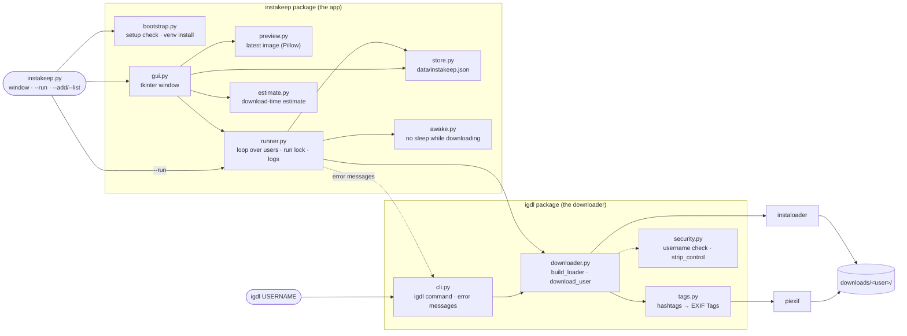

# InstaKeep Software Design Document

This document describes how InstaKeep works inside and why it's built that way, plus how to develop and release it (§12). For how to use it, see the [README](../README.md).

## 1. Purpose and scope

InstaKeep keeps a list of public Instagram profiles and downloads each one's newest posts. It runs as a tkinter window or headless (`instakeep.py --run`, for a scheduled task). A second command, `igdl`, downloads one profile from the terminal.

It's built on [instaloader](https://instaloader.github.io/), which makes the Instagram requests, handles paging and retries, and writes the files.

There's no login, and there won't be one, so only public profiles work. There are no credentials, session files or 2FA flows. A login would bring account bans, secret storage and a larger attack surface, none of which fit a tool that keeps a list and saves new posts. Code must not add credential or session handling.

## 2. Architecture

### 2.1 Packages

There are two packages under `src/`, and dependencies only go one way: `instakeep` → `igdl`, never the reverse.

- `igdl` is the download library plus the `igdl` console script. It knows nothing about the saved list, the store or the window. It's an internal boundary only and isn't published on its own.
- `instakeep` is the app: setup check, saved list, run loop, window.

`instakeep.py` (repo root) is the entry point: `bootstrap.ensure_ready()` → a `store.Store` → one of `gui.App`, `runner.run_headless()` (`--run`), or the list commands.



### 2.2 Modules

| Path | What |
|------|------|
| [`instakeep.py`](../instakeep.py) | Entry point: setup check, then window or command-line mode. |
| [`src/instakeep/bootstrap.py`](../src/instakeep/bootstrap.py) | Setup check and venv install (standard library only). |
| [`src/instakeep/paths.py`](../src/instakeep/paths.py) | Absolute paths of `data/`, `logs/`, `downloads/`, `.venv/` and the lock file. |
| [`src/instakeep/store.py`](../src/instakeep/store.py) | Saved users, settings and per-user records in `data/instakeep.json`. |
| [`src/instakeep/runner.py`](../src/instakeep/runner.py) | The run over every user, run order, rename following, run lock, `--run` logging. |
| [`src/instakeep/estimate.py`](../src/instakeep/estimate.py) | Download-time estimates (pure functions over the store's records). |
| [`src/instakeep/awake.py`](../src/instakeep/awake.py) | Keeps the computer awake and the screen on while a download runs. |
| [`src/instakeep/preview.py`](../src/instakeep/preview.py) | Finds, loads and captions the newest downloaded image. |
| [`src/instakeep/gui.py`](../src/instakeep/gui.py) | The tkinter window: From User, From Link and From File tabs, preview, log. |
| [`src/igdl/cli.py`](../src/igdl/cli.py) | The `igdl` command; maps errors to messages and exit codes. |
| [`src/igdl/downloader.py`](../src/igdl/downloader.py) | Configures instaloader, reports rate-limit pauses, runs the per-profile loop, downloads a single post, looks up renamed accounts. |
| [`src/igdl/tags.py`](../src/igdl/tags.py) | Writes caption hashtags into a JPEG's EXIF Tags. |
| [`src/igdl/security.py`](../src/igdl/security.py) | Username and post-link checks, stripping control and bidi characters, one-line error messages. |
| [`docs/make_screenshots.py`](make_screenshots.py) | Remakes the README screenshots from made-up users and links (Windows; nothing is downloaded). |

### 2.3 Dependencies

Runtime dependencies are `instaloader` (`>=4.14,<5`), `piexif` and `pillow`. The window is standard-library tkinter.

- instaloader is capped below 5. Its minor releases are usually fixes for Instagram changes, which we want; a major release could change the API that `downloader.py` depends on (a `RateController` subclass, exception types, file-name patterns). Every instaloader touchpoint stays inside `igdl/downloader.py` and `cli.describe_error()`. There's no adapter layer, because there's no second backend to swap in.
- piexif writes EXIF Tags without re-encoding the image.
- Pillow is only for the image preview, because tkinter can't show JPEG.

Adding a runtime dependency means updating `pyproject.toml`, `bootstrap.REQUIRED_MODULES` and the setup table in the README. Prefer the standard library.

The version is written in three places, `pyproject.toml`, `igdl.__version__` and `instakeep.__version__`, and they must match (a test checks, §12).

## 3. Startup and setup

`python instakeep.py` works with nothing installed.

| Check | If it fails |
|-------|-------------|
| Python 3.10+ | Explains and exits. |
| tkinter (window only) | Prints the install command for the OS. |
| instaloader, piexif, Pillow (`REQUIRED_MODULES`) | Asks, then creates `.venv`, runs `pip install -e .` into it, and restarts inside it. |

From then on, `instakeep.py` relaunches itself inside `.venv` whenever one exists. `--check` prints the status. A `--run` never asks (there may be no one to answer); setup messages also go to the `--run` log, because `pythonw` has no console.

Stdlib-only until setup passes. Before `ensure_ready()` returns, `instakeep.py` imports only `igdl.security`, `instakeep.__init__`, `bootstrap` and `paths`. Those modules must stay standard-library only: no instaloader, piexif or Pillow, and no other `igdl` module. Everything else is imported after the check.

The self-installing venv is kept on purpose: "clone and run `python instakeep.py`" is the simplest install for non-developers, and CI tests it. Packaging (pipx, a frozen exe) would replace `bootstrap.py` only if InstaKeep is handed to people without Python.

Paths in `paths.py` are absolute, based on the file's location, so the program works from any working directory. `data/`, `logs/`, `downloads/` and `.venv/` are created at runtime and git-ignored.

## 4. Data: `data/instakeep.json`

### 4.1 Layout

```json
{
  "version": 3,
  "settings": {"limit": 5, "all_posts": false, "output_dir": "...", "images": true,
               "videos": false, "caption": false, "tags": true, "metadata": false},
  "users": [
    {"username": "natgeo", "last_run": "2026-11-03T11:20:00", "last_status": "ok, 3 new",
     "last_ok": "2026-11-03T11:20:00", "userid": 787132, "folder": null,
     "full_scan_done": true, "stats": {"runs": 4, "seconds": 120.5, "...": 0}}
  ]
}
```

Settings (`store.default_settings()`):

| Key | Default | Meaning |
|-----|---------|---------|
| `limit` | 5 | Newest N posts per user. |
| `all_posts` | false | Every post; `limit` is ignored. |
| `output_dir` | `downloads/` | Where user folders go. |
| `images` | true | Download photos. |
| `videos` | false | Download videos. At least one of `images`/`videos` must be on. |
| `caption` | false | Save `<name>.txt` with the caption. |
| `tags` | true | Write caption hashtags into image Tags. |
| `metadata` | false | Save `<name>.json` with the post's full data. |

Per user:

| Field | Meaning |
|-------|---------|
| `username` | Lowercase, validated. |
| `last_run`, `last_status` | The latest run, successful or not (`ok, 3 new`, `not found`, `rate-limited`, ...). |
| `last_ok` | The latest successful run. Decides the run order (§6.2). |
| `userid` | Instagram's account ID, saved after each successful run. Used to follow renames (§6.4). |
| `folder` | The folder name if it differs from the username (after a rename); `null` otherwise. |
| `full_scan_done` | A full pass over every post has finished, so "all posts" runs may stop early (§5.4). |
| `stats` | Download records for the estimates (`store.STAT_FIELDS`). |

Stats are numbers ≥ 0. Each run's numbers are added up, except `media_count`, `last_seconds`, `last_images` and `last_videos`, which each run replaces (a run that didn't learn `media_count` keeps the old one), and `longest_seconds`, which keeps the larger value. Fields: `runs` (finished downloads only), `seconds`, `pause_seconds`, `posts` (looked at), `new_posts`, `images`, `image_seconds`, `videos`, `video_seconds`, `queries`, `media_count`, `last_seconds`, `last_images`, `last_videos`, `longest_seconds`.

### 4.2 Validation

The file is sometimes edited by hand, so nothing in it is trusted. `Store._clean()` validates every setting against `default_settings()` and every user field against `new_user()`: wrong types fall back to defaults, invalid usernames and folders are skipped, duplicates are dropped, and unknown keys are removed. A new setting or field must be added there, or it's discarded on load. A corrupt file is copied to `instakeep.json.bak` and the store starts fresh.

### 4.3 Two processes, one file

The window and `--run` are separate processes sharing the file.

- `Store._mutate()` re-reads the file, applies the change, then writes atomically (temp file + `os.replace`), so neither process overwrites the other's results and a crash never leaves half a file.
- That doesn't stop a lost update when two writes interleave exactly (read A, read B, write A, write B). Writes are rare and small and `RunLock` keeps downloads apart, so this is accepted. If results ever go missing in practice, the fix is a short file lock around `_mutate()`. Moving to SQLite was considered and isn't needed.
- `runner.RunLock` stops both from downloading at once (§6.5).

### 4.4 Versions and migrations

The file has a `version` (`store.STORE_VERSION`, now 3). Files from before versions existed count as 1. Changing the file's layout means bumping it, plus a step in `store.MIGRATIONS` if `_clean()`'s defaults aren't enough. Version 2 added the per-user fields `userid`, `folder`, `full_scan_done` and `last_ok`; version 3 added the `images` setting.

A newer file is never written by an older build. Since `_clean()` drops unknown keys, an older build saving a newer file would quietly wipe the newer fields. This happens when a window left open since before a `git pull` keeps running the old code while the next `--run` uses the new code. So every read checks the version. If the file is newer, the store becomes read-only (`store.too_new`) and every write raises `NewerStoreError` without touching the file:

- The window turns off downloading and editing, says "Read-only: a newer InstaKeep updated the data file. Restart InstaKeep.", and warns once.
- `--run`, `--add`, `--remove` and `--rescan` exit with code 3. `--list` still works.
- A run checks before it starts (`Store.check_writable()`), so it never downloads everything and then fails to record it.

Keeping unknown keys instead was rejected: it only works while every change just adds fields, and it would stop `_clean()` cleaning up hand-edited files.

## 5. Downloading (`igdl`)

### 5.1 The loader

`downloader.build_loader()` configures instaloader:

- Files go to `<output_dir>/<folder>/`.
- Images on, videos off by default. With videos off, video and video-thumbnail downloads are off, so video slides in carousels are skipped entirely. With images off, pictures and video covers are skipped.
- No geotags or comments (each would need extra requests).
- Caption `.txt` and metadata `.json` (uncompressed) are opt-in.
- Rate limiting goes through `_PauseAwareRateController` (§5.7).
- instaloader's output is passed through `strip_control()`.

### 5.2 File names: a fixed contract

```
DIRNAME_PATTERN  = "{target}"
FILENAME_PATTERN = "{target}_{date_utc:%Y-%m-%d_%H-%M-%S}_{shortcode}"
```

For example, `natgeo_2026-11-01_23-53-04_DfN9Oosk9s2_1.jpg`. `{target}` is the folder name: the lowercase username, or after a rename the old one.

| File | When |
|------|------|
| `.jpg` | Images on. Carousels get `_1`, `_2`, … suffixes. |
| `.mp4` | Videos on (plus a cover `.jpg` when images are on too). |
| `.txt` (caption) | Captions on. |
| `.json` (full post data) | Metadata on. |

Whether a post is already downloaded is worked out only from these names. Changing them, or renaming files by hand, makes everything download again. A test pins both patterns. Folder names are always lowercase.

### 5.3 What a run downloads

| | Images only (default) | Images + videos | Videos only |
|---|---|---|---|
| Photo posts | saved | saved | skipped |
| Video and reel posts | skipped | `.mp4` + cover image | `.mp4` |
| Carousels | photos | photos + videos (+ covers) | videos only |

Skipped posts are dropped before the limit counts anything, so "Newest 5" means 5 posts that will actually be saved. With videos only, single-image posts are dropped, but carousels stay (they can hold videos). A carousel made only of images then counts toward the limit and saves nothing; checking each carousel's contents could cost extra requests, so this is accepted.

Pinned posts. A profile can pin up to 3 posts (`MAX_PINNED`), which Instagram always lists first whatever their date. With a limit, the loop reads `limit + 3` posts and keeps the newest `limit` by date, so an old pinned post doesn't take a slot. A pinned post is included only if it's among the newest.

Posts are listed lazily (pages of about 12), so a limit avoids fetching more pages than needed.

### 5.4 Early stop for "all posts"

Without an early stop, "all posts" pages through the entire profile on every run: about one request per 12 posts, so roughly 250 requests for a 3,000-post profile, which hits the rate limit for nothing.

`download_user(stop_at_known=True)` ends the loop after `KNOWN_STREAK` (3) posts in a row that already had media on disk, not counting the first `MAX_PINNED` posts (which can be old pinned posts). It waits for three in a row so that a gap left by an interrupted run isn't taken as the end. The runner only asks for this once the user has had a full pass (`full_scan_done`). It's never used with a limit.

`DownloadStats.complete` is true only when every post was looked at: no limit, no early stop, no error, no Stop. Only such a run sets `full_scan_done`, and only such a run may stand in for a missing post count (§7). "Full re-scan" (the Full re-scan selected button, `--rescan`, `Store.request_full_scan()`) clears `full_scan_done`, so the next "all posts" run looks at every post again.

### 5.5 Single post

`download_single_post()` takes a shortcode from `security.parse_post_url()` (links to `/p/`, `/reel/`, `/reels/` or `/tv/`, optionally after the account name; anything after the code is ignored). It makes one request for the post's data, checks the owner's name with `is_valid_username()`, and saves into the owner's folder (or the folder `folder_for(owner)` gives, for a renamed account) with the same file names, so a later batch run skips it. A video post with videos off, or an image post with images off, is skipped with a log line. Logged out, Instagram answers a deleted post and a private account's post the same way, so both give "couldn't be loaded".

### 5.6 Hashtag Tags

With `tags` on, every image of a post gets the caption's `#hashtags` in its EXIF `XPKeywords` field, which Windows Explorer shows under Properties → Details → Tags (and finds with `tags:#portrait`). No extra file is created.

| Caption | Tags written |
|---------|--------------|
| `Wow this #portrait is awesome.` | `#portrait` |
| `#film #Portrait, shot on #cinestill800t #film` | `#film; #Portrait; #cinestill800t` |

- A tag is `#` followed by letters, digits or `_`, in any language. Duplicates are dropped, ignoring case.
- piexif inserts the field without re-encoding, so image quality doesn't change. Only `.jpg` files get tags.
- Each run also tags earlier downloads that don't have Tags yet.

### 5.7 Rate limits

Rate limiting is left to instaloader's `RateController`: about 200 requests of a kind per 11 minutes (`QUERY_LIMIT` per `QUERY_WINDOW`), after which it pauses. InstaKeep never shortens or skips a pause. `_PauseAwareRateController` is always installed and adds three things:

- a notice for pauses over 15 s (`format_pause`: "Instagram rate limit: pausing 6 min (until 14:05)"), even with `quiet=True`;
- stopping during a pause, by sleeping in half-second steps and checking `should_stop()`;
- counters for requests and paused seconds, for the estimates.

### 5.8 Callbacks and records

`download_user()` fills an optional `DownloadStats`: the profile's post count and ID, posts looked at, new posts, new image and video files with their download times (a carousel's time is split by file count; posts already on disk and rate-limit pauses are left out), requests, pauses, and `complete`.

`download_user()` and `download_single_post()` take `on_saved(SavedPost)`, called on the downloading thread after each post that saved new media files (after its Tags are written). `SavedPost` has the account, shortcode, post date, and the new files in slide order. The window uses it for the preview.

`should_stop()` is checked before each post; the post being saved always finishes first.

### 5.9 Renamed accounts

`username_for_id(loader, userid)` returns an account's current lowercase name from its ID, or `None` if there's no such account, Instagram won't say, or the name isn't a valid username. Without a login, Instagram may refuse this lookup; it's only been tested with fakes. If it never works anonymously, a renamed user just stays "not found", as before.

## 6. The run (`runner.py`)

### 6.1 `run_all()`

`run_all()` is shared by the window and `--run`:

1. `store.check_writable()`, which also picks up the other process's changes. A newer data file stops the run here (§4.4).
2. One settings snapshot, so a change mid-run can't mix values.
3. If both images and videos are off: log "nothing to download" and return.
4. One loader for the whole run, so every user's requests count toward the same rate limit. instaloader's non-fatal warnings go to the log.
5. For each user, in run order: download, count new files, record the result and stats.

It takes injectable `build_loader`, `download_user`, `describe_error` and `lookup_username`; the tests pass fakes through these.

### 6.2 Run order

A full run (no selection) starts with whoever has gone longest without a successful download (`last_ok`; never-downloaded first), with ties in list order. Without this, a rate limit that always strikes around user 15 means users 16 and up never download. A failed or rate-limited run doesn't set `last_ok`, so that user keeps their place in line. "Download Selected User" keeps the list order.

### 6.3 Failures

- One user failing doesn't stop the others.
- A rate-limit or connection error (exit code 4) ends the whole run: the remaining users would hit the same block.
- Time and files from a failed or stopped run still count toward the totals, but only finished runs count as runs.

### 6.4 Following renames

When a user isn't found and has a saved `userid`, `_follow_rename()` looks the ID up:

- New name found: `Store.rename_user()` switches the list entry to the new name and sets `folder` to the old folder, so new posts land next to the earlier ones. The new name downloads from the next run. A second rename keeps the first folder.
- New name already in the list: nothing changes; the log suggests removing the old entry.
- No answer: logged; the user stays "not found".
- A rate-limited lookup ends the run like any rate limit (the run then exits 1, not 4, because the user's own result is "not found").

### 6.5 Run lock

`RunLock` (`data/run.lock`) holds the PID of the process downloading. It's created with `O_EXCL`, so of two processes starting at once only one wins. The window (every tab) and `--run` all take it; whichever starts second gives up and says so (`--run` exits 5).

While held, a heartbeat thread touches the file every 60 seconds. A lock is stale, and taken over, when its process is gone or it hasn't been touched for an hour. That way a run of any length keeps its lock (a big "all posts" run with long pauses can pass 24 hours), and a crashed one frees it within the hour even if Windows reused its PID.

### 6.6 Keeping the computer awake

`awake.keep_awake()` wraps every download (the window's batch and single-post downloads, and `run_headless`), inside the lock:

- Windows: `SetThreadExecutionState(ES_CONTINUOUS | ES_SYSTEM_REQUIRED | ES_DISPLAY_REQUIRED)`. The request belongs to the calling thread, so it's set and cleared on the downloading thread, and Windows drops it if that thread ends.
- macOS: `caffeinate -d -i -w <pid>`, which ends by itself if InstaKeep exits.
- Linux: `systemd-inhibit --what=sleep:idle ... sleep infinity`, if available.

Both the system and the screen are kept on. On PCs with Modern Standby, the screen turning off is what starts standby, which pauses desktop programs and turns off the network; on battery, Windows ignores a sleep-only request once the screen is off. In November 2026 a locked laptop on battery went into standby mid-download, and the stale connection then failed with `ConnectionResetError(10054)` until instaloader retried. The lock screen can still be used; it just stays lit. Closing the lid or pressing the power button still sleeps. If no method is available, the download runs anyway and the log says so.

### 6.7 `--run` logging

`--run` appends to `logs/run-YYYY-MM-DD.log` and keeps the newest 30 log files. Every line goes through `strip_control()`. An unexpected error is logged with its traceback.

## 7. Download-time estimates (`estimate.py`)

The From User tab estimates Download All Users and Download Selected User from each user's records. Users never downloaded are left out (nothing to go on) and counted separately. Defaults fill in what the records don't say yet (1.5 s per image, 8 s per video, 1.5 files per post, 25% videos when videos are on).

- Time per new post: files per post × (image share × seconds per image + video share × seconds per video). With images off, everything is video.
- Time per post looked at: leftover time (total minus file time, pauses and per-user lookups) divided by posts looked at.
- New posts with a limit: as many as the last download found, up to the limit. "Up to" (the worst case) assumes all are new.
- All posts, full pass: everything not on disk yet plus what's new, looked at over the whole profile: per-post rates × the profile's post count.
- All posts after a full pass (`full_scan_done`): only the new posts, plus the pinned ones and the 3 known posts that end the run.
- Post count: Instagram's own count when it gives one; otherwise the posts a full pass saw. A run that stopped early never sets it, so the estimate doesn't think a profile has 4 posts.
- Rate-limit pauses: the larger of instaloader's limit (every 200 requests past the first 200 cost one 11-minute window) and the pause time per request earlier runs actually saw (which includes Instagram's own blocks).

Everything here is a pure function: no files, no network.

## 8. The window (`gui.py`)

### 8.1 Layout

```
┌──────────────────────────────────────────┬──────────────────────┐
│ [From User] [From Link] [From File]      │ Latest Image         │
│  table · add/remove · limit · estimate   │  (photo)             │
│  Download All Users / Selected User      │  caption · Open Image│
├──────────────────────────────────────────┴──────────────────────┤
│ Download Options: Images Videos Caption #tags Metadata · folder │
│ [Stop] [Open Folder]                           [x] Show Preview │
│ log                                                             │
│ status line                                                     │
└─────────────────────────────────────────────────────────────────┘
```

Only one download runs at a time. Option changes are saved as they're made (half-typed numbers are skipped).

### 8.2 From User tab

User table. Last download, Result, Downloaded and Time describe the latest run; Time ticks while that user downloads. Longest is the slowest run; Total time, Images and Videos add up every run.

- Cells are right-aligned; headings are centered.
- Each column is exactly as wide as its longest text (heading included, plus room for the sort arrow) plus a 12-pixel margin, measured in the real fonts so nothing is cut off on high-DPI screens. Columns don't stretch. The ticking Time cell widens its column if needed.
- Clicking a heading sorts by that column, again to reverse (▲/▼). Sorting compares the underlying values, so "45 s" sorts before "1 min 15 s" even though it wouldn't as text. Never-downloaded users sort first when ascending, and ties keep list order. The sort lasts for the session and doesn't change the download order.
- Grid lines are drawn as thin frames placed over the table (ttk's Treeview has none), redrawn after scrolling, resizing, column dragging and row changes. Vertical lines start below the headings so column edges can still be dragged. A click on a line selects the row under it.
- Every other row is light blue (`STRIPE_COLOR`), counted in display order so the stripes stay even after sorting.
- Row height comes from the font's line height, since ttk's fixed default cuts off text on high-DPI screens.

Controls. Add (validated, `@name` accepted, duplicates refused), Remove Selected (asks first; files are kept), Full re-scan selected, Download all posts / Newest N, the estimate, Download All Users / Download Selected User.

### 8.3 From Link tab

A post link box, Download post, and "Also add the post's account to the saved list". Open Folder on this tab opens the last post's account folder.

### 8.4 From File tab

Reads usernames and post links from a `.txt` file and shows them in two lists (Usernames, Direct links), both multi-select.

- Browse loads at once; Load re-reads the same path. Each load replaces both lists, which are not saved between sessions.
- The file is checked first (`security.read_entries_file`): `.txt` only (no CSV or JSON), a regular file, at most 64 KB and 100 non-blank lines, strict UTF-8 (a BOM is fine), no control characters. Otherwise the whole file is refused with a warning and the lists stay as they were.
- Then each line (`security.parse_entries`): a line is a link if `parse_post_url_strict` accepts it (https only; host exactly `instagram.com` or `www.instagram.com`; no userinfo, port or `m.`; the whole line must match), else a username (`@` allowed, lowercased), else rejected. Comments, CSV rows and JSON are rejected. Rejected lines are skipped and counted, and the first five are shown in the log. Duplicates are dropped. Only the shortcode is used; the list shows the link rebuilt from it.
- Usernames are only added to the saved list (Add All Users / Add Selected). Ones already saved show "(already listed)".
- Links download one after another in one run (`_run_links`): one `RunLock`, one loader, one `keep_awake`. A link that fails for a known reason is logged and the rest go on; a rate limit or Stop ends the run. "Also add each link's account" works as on the From Link tab. The "newest N posts" setting doesn't apply to a single post.
- Rows stay after an action; results go to the log and status line.

### 8.5 Image preview

The right side shows the image downloaded most recently in this session (Pillow, since tkinter can't show JPEG).

- After each post with new media, `_on_saved` runs on the worker thread, picks the post's last image (videos are never previewed), and loads it with `preview.load_preview()`: JPEG draft decoding at reduced size, EXIF rotation, at most 1080 px. The Tk thread then fits it to the panel and makes the `PhotoImage`, so big photos don't freeze the window.
- The caption is `@account · post date · shortcode`, plus `image 2 of 3` for carousels.
- Only images downloaded since the window opened are shown. Until the first one arrives, the panel says "No image yet"; earlier downloads on disk are never loaded.
- The panel has a fixed starting size (18 text lines square, scaling with the screen) and refits when the window is resized.
- Show Preview hides or shows the column. While hidden, nothing is loaded; turning it back on shows the newest image saved meanwhile. It's on at every start and isn't saved.
- Open Image opens the file in the system viewer, only if it's an image file that exists.
- A broken file gives no preview. Pillow refuses "decompression bomb" images on its own.

### 8.6 Threading

Downloads run on a worker thread that never touches widgets: tkinter isn't thread-safe. The worker posts tuples to `App.messages`, which `_poll_messages()` drains on the Tk thread every 100 ms:

| Message | Meaning |
|---------|---------|
| `("log", text)` | Add a line to the log. |
| `("pause", seconds)` | A rate-limit pause started. |
| `("user_start", name)` | A user started; its timer starts. |
| `("user_done", result)` | A user finished; refresh its row. |
| `("post_owner", name, add)` | Single post: its account is known; add it to the list if asked. |
| `("preview", image, path, caption)` | A newly saved image, loaded and shrunk. |
| `("done", text, ok)` | The run finished. Every outcome ends with exactly one, so the buttons always come back. |

Tk variables are read into plain values before the worker starts. The worker may read `threading.Event`s (`stop_requested`, `preview_on`).

### 8.7 Stop and close

Stop is checked before each post (the current post finishes first) and every half second during a rate-limit pause. Closing during a download asks first.

## 9. Command line

### 9.1 `instakeep.py`

| Option | What |
|--------|------|
| (none) | Open the window. |
| `--run` | Download for every saved user, no window. |
| `--check` | Show the setup status. |
| `--list` | Print the saved users. |
| `--add NAME...` | Add users. |
| `--remove NAME...` | Remove users. |
| `--rescan NAME...` | Make the next "all posts" download of these users look at every post again. |

| Exit code (`--run`) | Meaning |
|---|---|
| 0 | Every user OK. |
| 1 | At least one user failed, or a bug (with a traceback). |
| 3 | Setup incomplete, or the data file was saved by a newer InstaKeep. |
| 4 | Rate-limited or blocked by Instagram. |
| 5 | Another download was already running. |
| 130 | Interrupted (Ctrl+C). |

### 9.2 `igdl`

```
igdl USERNAME [-o DIR] [--limit N] [--videos] [--no-images] [--caption] [--no-tags] [--metadata] [-q]
```

`--no-images` needs `--videos`. The default output is the repo's `downloads/`, wherever `igdl` is run from. With `-q`, rate-limit pauses are still announced on stderr.

| Exit code (`igdl`) | Meaning |
|---|---|
| 0 | Success. |
| 1 | Profile not found (or a bug, with a traceback). |
| 2 | Private profile. |
| 4 | Rate-limited, blocked, or another network error. |
| 130 | Interrupted (Ctrl+C). |

Exit codes are documented for scripts, so they're never renumbered.

## 10. Errors

- Known instaloader errors become one line through `cli.describe_error()`, the single mapping shared by the CLI, the runner and the window. Order matters: `TooManyRequestsException` is a kind of `ConnectionException`, and 401/429 blocks arrive as generic connection errors, so the message is checked for those codes. For a single post, a missing post and a private account's post are mapped first.
- Unexpected errors keep their traceback. `igdl` and `instakeep.py`'s `run()` re-raise (a `--run` copies it into the log first). Where there's no terminal (the window worker, Tk callbacks, `--run`), `security.describe_unexpected()` gives a summary line plus the full traceback; dialogs show only the first line.
- Broad `except` only at boundaries where the failure must still reach the user (the worker, Tk callbacks, the `--run` loop, the per-user loop), each marked `# noqa: BLE001 - <reason>`.
- Messages are plain English: what happened and what to do next.

## 11. Untrusted input

Usernames, captions, error text and anything else from Instagram are untrusted.

- Every username goes through `security.is_valid_username()` (letters, digits, `.` and `_`, up to 30) before it's used in a request or a path. That rules out `../` tricks. The list stores names lowercase (`normalize_username`, which also accepts `@name`). Saved folder names pass the same check.
- Text that's printed, logged or shown goes through `strip_control()`, which removes C0/C1 control characters (except tab and newline, so no ANSI escapes) and Unicode bidi overrides and isolates.
- Post links are reduced to their shortcode; nothing else from the pasted text reaches a request or a file name.
- `subprocess` is only called with argument lists, never `shell=True`. "Open Folder" and "Open Image" check the path is a folder or an image file first (`os.startfile` on a program would run it).

## 12. Testing, CI and releases

```powershell
.venv\Scripts\pip install -e .[dev]
.venv\Scripts\python -m pytest
.venv\Scripts\ruff check .
```

- Tests never touch the network. Instagram access is replaced with fakes through the injectable parameters or `monkeypatch`.
- Tests are headless: `tests/conftest.py` hides every Tk window, records message boxes and file dialogs in the `dialogs` fixture, and points `paths` (data, logs, lock, downloads) at the temp folder. Window tests share one session Tk root and give each test a hidden `Toplevel`, because creating many `tk.Tk()` roots in one process fails on Windows.
- A hidden window reports no row positions, so grid-line tests use made-up positions.
- EXIF tests use real JPEGs built with piexif; preview tests use real JPEGs built with Pillow.
- Behavior changes come with a test.
- `tests/test_project.py` checks two project rules: the three version strings (`pyproject.toml`, `igdl.__version__`, `instakeep.__version__`) match, and the pre-setup modules (§3) import only the standard library, in a fresh `python -I`.

CI (`.github/workflows/tests.yml`) runs Ruff and the whole suite on every pull request and every push to `main`, on Windows, Linux (under `xvfb`) and macOS with Python 3.10 and 3.14. A newer push cancels the run still going for it. Ruff (configured in `pyproject.toml`: its default rules plus bugbear) is pinned in CI; there's no formatter.

To release a new version:

1. Set it in `pyproject.toml`, `src/igdl/__init__.py` and `src/instakeep/__init__.py`.
2. Commit to `main`.
3. Push a tag: `git tag v0.2.0 && git push origin v0.2.0`.

Releases (`.github/workflows/release.yml`) start from that pushed `v*.*.*` tag. The tag must match the `pyproject.toml` version, and the same Ruff + test matrix must pass. Then the workflow publishes a GitHub Release with generated notes and `InstaKeep-<version>.zip`, made by `git archive`. `.gitattributes` leaves developer files (`.github/`, `CLAUDE.md`, `memory/`, `docs/make_screenshots.py`) out of the zip. The zip is the whole install: users unzip it and run `python instakeep.py`, and the first start builds `.venv` as usual (§3).

## 13. Design decisions

From the design review in November 2026.

| Decision | Why |
|----------|-----|
| No login, ever. | Bans, 2FA and secret storage don't fit the tool. |
| `igdl` stays a separate internal package with its CLI; not published. | A clean boundary and a handy one-off command, without a public API to maintain. |
| Accept tight coupling to instaloader; cap below 5. | No second backend exists; minor releases carry Instagram fixes. |
| Accept the small lost-update window in `_mutate()`. | Writes are rare; a file lock is the fix if it ever shows up. |
| Version the data file; older builds refuse to write newer files. | Silent data loss is worse than a forced restart. |
| Keep the self-installing venv. | Simplest for non-developers, tested in CI. |
| Track users by ID as well as name; follow renames, keep the old folder. | A rename otherwise cuts the history off. |
| Stop "all posts" runs at 3 known posts in a row after a full pass; offer a full re-scan. | Saves hundreds of requests per run on big profiles; the re-scan fills gaps. |
| Only full passes set `full_scan_done` and stand in for the post count. | An early stop sees only a few posts. |
| Run order by least recent `last_ok`. | A rate limit otherwise starves the end of the list. |
| Run-lock heartbeat with a 1-hour staleness. | Long runs keep the lock; crashed ones free it, even with a reused PID. |
| Fixed file-name contract, lowercase folders. | "Already downloaded" depends on them. |
| Estimate full passes per post, incremental runs from new posts only. | Mixing both kinds of run in one average gives nonsense. |
| Keep the computer awake and the screen on during downloads only. | Locked laptops on battery entered standby mid-download; an idle window shouldn't block sleep. |
| Add Pillow for the preview. | tkinter can't show JPEG. |
| "Show Preview" is on at every start and not saved. | It only changes the view; nothing else depends on it. |

## 14. Known limitations

- Only public profiles. Logged-out visitors may be shown fewer posts or blocked (401/429); waiting and retrying is the fix.
- Rate-limit pauses can last minutes; the download carries on afterwards.
- Looking up a renamed account by ID hasn't been tested against real Instagram and may not work without a login.
- With images off, a carousel made only of images counts toward the limit and saves nothing.
- A rate-limited rename lookup makes `--run` exit 1 instead of 4.
- Closing a laptop lid or pressing the power button still sleeps mid-download.
- On Linux, keeping the screen on depends on the desktop.
- Image previews have only been checked in hidden test windows, not on screen.
